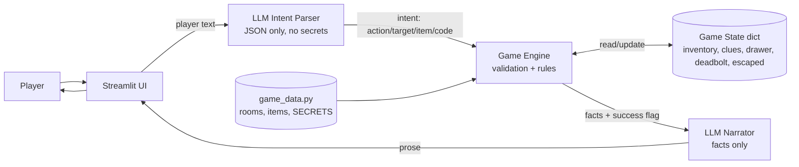

# Architecture

## Version 1 - LLM does everything
```mermaid
flowchart LR
    P[Player] -->|natural language| UI[Streamlit UI]
    UI -->|full chat history + system prompt<br/>(room, secrets, rules)| LLM[Gemini API]
    LLM -->|narration + rule decisions| UI
    UI -->|checks for token [ESCAPED]| W{Win?}
    UI --> P
```
State = chat history only. Rules and secrets are *inside the prompt*, so the LLM is both narrator and referee.

## Version 2 - Python decides, LLM describes

Fallback: with no API key (or on API error) a keyword parser and plain-fact narration are used, so the game still runs.
